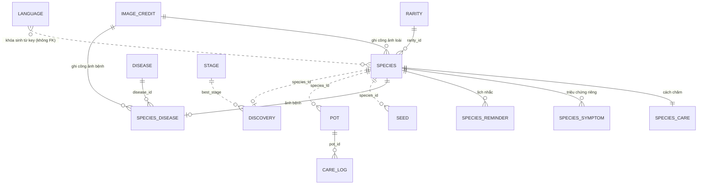

# Schema dữ liệu cho Plant Identifier

Thiết kế theo quy ước bảng `language` ở `E:\ALF\WorkoutApp\design-note\language-table-convention.md`. Tài liệu này áp dụng quy ước đó cho app cây cảnh.

## 0. Tóm tắt

App có **hai luồng dữ liệu**:

| Luồng | Là gì | Ai ghi | Lưu ở đâu | Khi cập nhật app |
|---|---|---|---|---|
| **Catalog** | Dữ liệu có sẵn: loài cây, cách chăm, bệnh, ảnh, giai đoạn, độ hiếm, **bảng `language`** | Nhà phát triển | Đóng gói trong app (JSON + ảnh trong `imgs/`) | Thay mới theo phiên bản |
| **Runtime** | Dữ liệu sinh ra khi dùng: hạt, chậu, bộ sưu tập, cài đặt | Người dùng | Máy người dùng (hiện là `localStorage`, key `plantin-recreated-v2`) | Giữ nguyên, chỉ migrate |

**Quy tắc cốt lõi**

1. **Bảng nội dung chỉ giữ dữ liệu không phụ thuộc ngôn ngữ.** Mọi chữ hiển thị (tên, mô tả, mẹo, ghi chú...) nằm ở bảng `language`, tra bằng khóa dịch sinh từ `key` của thực thể.
2. **Không có cột `*_key` và không có khóa ngoại tới `language`.** Khóa dịch suy ra được từ `key`, độ phủ được kiểm tra bằng Check i18n (mục 6).
3. Catalog **chỉ đọc** lúc chạy. Runtime **không chép nội dung catalog**, chỉ giữ `key` của loài để tra. Không có khóa ngoại cứng giữa hai luồng; nếu `species_id` biến mất khỏi catalog, app vẫn chạy và hiện nhãn dự phòng.
4. Giá trị **tính ra được thì không lưu** (trạng thái chậu, giai đoạn, danh sách thông báo).
5. `key` sinh một lần và **không đổi nữa**. Muốn đổi cách hiển thị thì sửa chữ ở `language`.

---

## 1. Quy ước khóa

`key` của mọi thực thể: chữ thường, số và `_`; không dấu, không khoảng trắng, **không dùng `-`**.

`key` viết bằng **tiếng Anh** (tên thường gọi của loài/bệnh), ví dụ `snake_plant`, `golden_pothos`, `mealybugs`. Không dùng tên tiếng Việt không dấu như `luoi_ho`.

> **Thay đổi so với hiện tại.** Các `id` trong `App/src/mock-data/species.ts` là tiếng Việt có dấu gạch ngang (`luoi-ho`, `xuong-rong-cau`, `duong-xi-boston`). Chúng được đổi sang key tiếng Anh (`snake_plant`, `golden_barrel_cactus`, `boston_fern`...). Việc này cần **một migration cho runtime** (mục 7). Ảnh lưu theo key: `/imgs/<key>/<key>.webp`, `/imgs/<key>/<key>.thumb.webp`, ảnh bệnh `/imgs/<key>/<key>--<disease_key>.webp`; đường dẫn vẫn được lưu thẳng trong catalog, không suy từ `key`.

Khóa dịch: `<bảng>.<key>.<trường>`, toàn chữ thường, dấu chấm phân tách các phần.

### 1.1 Tên trường chuẩn

Các trường quy ước đã có sẵn: `title` (bắt buộc), `description`, `tip.N`. Trường dưới đây là **trường mới của app cây**, phải được thêm vào danh sách chuẩn của Toolkit/Check i18n trước khi dùng.

| Trường | Dùng cho | Bắt buộc | Có sẵn trong quy ước? |
|---|---|---|---|
| `title` | Tên hiển thị của thực thể (với triệu chứng: câu mô tả triệu chứng) | **Có** | Có |
| `description` | Mô tả dài | Không | Có |
| `tip.N` | Mẹo chăm sóc thứ N (liên tục từ 1) | Không | Có |
| `fact.N` | Điều thú vị thứ N (liên tục từ 1) | Không | **Mới** |
| `family` | Tên họ bằng tiếng Việt, ví dụ "họ Ráy" | Không | **Mới** |
| `origin` | Quê hương / nguồn gốc | Không | **Mới** |
| `light` | Yêu cầu ánh sáng | Không | **Mới** |
| `water_note` | Ghi chú tưới | Không | **Mới** |
| `fertilizer` | Loại phân | Không | **Mới** |
| `soil` | Loại đất / chậu | Không | **Mới** |
| `humidity` | Mô tả độ ẩm | Không | **Mới** |
| `cause` | Nguyên nhân (triệu chứng, bệnh) | Không | **Mới** |
| `fix` | Cách xử lý | Không | **Mới** |

### 1.2 Ví dụ khóa

| Thực thể | Khóa dịch |
|---|---|
| Loài `snake_plant` | `species.snake_plant.title`, `species.snake_plant.description`, `species.snake_plant.origin`, `species.snake_plant.tip.1`, `species.snake_plant.fact.1` |
| Giai đoạn `bloom` | `stage.bloom.title` |
| Độ hiếm `rare` | `rarity.rare.title` |
| Bệnh `mealybugs` | `disease.rep_sap.title` |
| Triệu chứng riêng `snake_plant_1` | `species_symptom.snake_plant_1.title`, `.cause`, `.fix` |
| Triệu chứng chung `gs_03` | `general_symptom.gs_03.title`, `.cause`, `.fix` |
| Ghi chú ảnh bệnh của loài | `species_disease.snake_plant.description` |
| Ghi chú lịch nhắc | `species_reminder.snake_plant_fertilize.description` |

---

## 2. Sơ đồ quan hệ



Nét liền `--` là khóa ngoại trong cùng luồng. Nét chấm `..` là tham chiếu mềm: `language` ↔ bảng nội dung (khóa sinh từ `key`), và runtime → catalog (chỉ bằng `key`). `language` không là khóa ngoại của bảng nào, và không bảng nào là khóa ngoại của nó.

---

## 3. CATALOG (chỉ đọc)

### 3.1 `language` — toàn bộ chữ hiển thị của nội dung

```sql
CREATE TABLE language (key TEXT PRIMARY KEY, vi TEXT NOT NULL, en TEXT);
```

| Cột | Ý nghĩa | Ràng buộc |
|---|---|---|
| `key` PK | Khóa dịch theo mục 1 | Duy nhất, chữ thường |
| `vi` | Bản tiếng Việt | **Bắt buộc**, không rỗng |
| `en` | Bản tiếng Anh | Được NULL; thiếu thì rơi về `vi` |

Ví dụ dòng:

| key | vi | en |
|---|---|---|
| `species.snake_plant.title` | Lưỡi hổ | Snake plant |
| `species.snake_plant.origin` | Tây Phi | West Africa |
| `species.snake_plant.tip.1` | Tưới ít, để đất khô hẳn giữa hai lần tưới. | *(NULL)* |
| `stage.bloom.title` | Ra hoa | In bloom |
| `rarity.rare.title` | Hiếm | Rare |

Thêm ngôn ngữ thứ ba thì không thêm cột `fr`, `th`...; đổi một lần sang dạng dọc `language_text(key, lang, text)` với khóa chính `(key, lang)`.

### 3.2 `rarity` — độ hiếm

| Cột | Kiểu | Ghi chú |
|---|---|---|
| `key` PK | text | `common` · `uncommon` · `rare` |
| `weight` | int | Trọng số khi quay hạt: 70 / 25 / 5 |

Chữ: `rarity.<key>.title` (Phổ biến / Ít gặp / Hiếm).

### 3.3 `stage` — giai đoạn sinh trưởng

| Cột | Kiểu | Ghi chú |
|---|---|---|
| `key` PK | text | `seed` · `sprout` · `young` · `mature` · `bloom` |
| `sort_order` | int | 0–4, dùng so sánh "giai đoạn cao nhất" |
| `emoji` | text | 🌰 🌱 🌿 🪴 🌸 (phi ngôn ngữ) |
| `min_days` | int | Ngày sinh trưởng tối thiểu: 0 / 1 / 3 / 7 / 14 |

Chữ: `stage.<key>.title` (Hạt / Mầm / Cây non / Trưởng thành / Ra hoa).

### 3.4 `species` — loài cây (31 dòng)

| Cột | Kiểu | Ghi chú |
|---|---|---|
| `key` PK | text | Slug theo mục 1, ví dụ `snake_plant` |
| `sort_order` | int | Thứ tự 1–31 trong dataset |
| `scientific_name` | text | Tên khoa học (Latin, phi ngôn ngữ) |
| `family` | text | Họ bằng tên Latin, ví dụ `Araceae` |
| `rarity_id` FK | text | → `rarity.key` |
| `thirst` | real | Hệ số mất nước (0,5–1,4) |
| `hunger` | real | Hệ số mất dinh dưỡng |
| `preferred_spot` | text | `sun` hoặc `shade` (enum, giao diện dịch bằng `t()` trong code). Đặt sai chỗ thì mất nước nhanh hơn 1,25 lần |
| `image` | text | Đường dẫn ảnh đầy đủ, ví dụ `/imgs/peace_lily/peace_lily.webp` |
| `thumb` | text | Đường dẫn thumbnail `.thumb.webp` |
| `image_credit_id` FK | text | → `image_credit.key` |

Chữ: `title` (bắt buộc), `description`, `family` (họ tiếng Việt), `origin`, `tip.N`, `fact.N`.

Đã bỏ khỏi bảng so với bản hiện tại: `name`, `description`, `origin`, `careTips[]`, `funFacts[]`, phần tiếng Việt trong `family`.

### 3.5 `species_care` — thông số chăm sóc (1–1 với `species`)

Tách riêng để danh sách/bộ sưu tập chỉ đọc bảng `species` nhẹ.

| Cột | Kiểu | Ghi chú |
|---|---|---|
| `key` PK, FK | text | = `species.key` |
| `water_days` | int | Chu kỳ tưới mặc định (mùa sinh trưởng) |
| `fertilize_weeks` | int | Chu kỳ bón (tuần) |
| `temp_min` | int | °C |
| `temp_max` | int | °C. Giao diện tự ghép thành "15–30 °C", không lưu chữ |
| `pet_safe` | bool | `false` thì cảnh báo độc với thú cưng |

Chữ: khóa mang `species_care.<key>.<trường>` với trường `light`, `water_note`, `fertilizer`, `soil`, `humidity`.

### 3.6 `species_symptom` — triệu chứng riêng của loài

Bảng con có chữ riêng nên có `key` riêng (mục 4.3 của quy ước).

| Cột | Kiểu | Ghi chú |
|---|---|---|
| `key` PK | text | `<species>_<n>`, ví dụ `snake_plant_1` |
| `species_id` FK | text | → `species.key` |
| `sort_order` | int | Thứ tự hiển thị |

Chữ: `title` (triệu chứng nhìn thấy), `cause`, `fix`.

### 3.7 `general_symptom` — triệu chứng dùng chung (14 dòng)

Tra sau khi `species_symptom` không khớp.

| Cột | Kiểu | Ghi chú |
|---|---|---|
| `key` PK | text | `gs_01` ... `gs_14` |
| `sort_order` | int | |

Chữ: `title`, `cause`, `fix`.

### 3.8 `species_reminder` — lịch nhắc mặc định

| Cột | Kiểu | Ghi chú |
|---|---|---|
| `key` PK | text | `<species>_<task>`, ví dụ `snake_plant_fertilize` |
| `species_id` FK | text | → `species.key` |
| `task` | text | `water` · `fertilize` · `check` · `repot` · `prune` · `mist` (enum) |
| `every_days` | int | Chu kỳ (ngày) |

Chữ: `description` (ghi chú, tùy chọn).

### 3.9 `disease` — danh mục bệnh / dịch hại

Một bệnh dùng chung nhiều loài (rệp sáp ở 5 loài).

| Cột | Kiểu | Ghi chú |
|---|---|---|
| `key` PK | text | Ví dụ `mealybugs`, `bacterial_leaf_spot` |

Chữ: `title` (bắt buộc), `description`.

### 3.10 `species_disease` — bệnh điển hình và ảnh của từng loài (1–1)

| Cột | Kiểu | Ghi chú |
|---|---|---|
| `key` PK, FK | text | = `species.key` |
| `disease_id` FK | text | → `disease.key` |
| `image` | text | Ví dụ `/imgs/peace_lily/peace_lily--fungal_leaf_spot.webp` |
| `thumb` | text | Thumbnail tương ứng |
| `image_credit_id` FK | text | → `image_credit.key` |

Chữ: `description` = ghi chú ảnh: chụp gì, trên cây nào. **Bắt buộc hiển thị** dưới ảnh vì ảnh thường chụp trên cây khác (Check i18n coi là lỗi nếu thiếu).

### 3.11 `image_credit` — ghi công ảnh

Lấy từ `imgs/sources.json`. Không có chữ cần dịch (tên file, giấy phép, địa chỉ), nên không có khóa dịch.

| Cột | Kiểu | Ghi chú |
|---|---|---|
| `key` PK | text | Ví dụ `snake_plant_species`, `snake_plant_disease` |
| `file_name` | text | Tên file trên Commons |
| `page_url` | text | `https://commons.wikimedia.org/wiki/File:...` |
| `source_url` | text | Link ảnh gốc đã tải |
| `license` | text | CC BY, CC BY-SA, CC0, public domain |
| `author` | text? | Chưa có trong `sources.json`, cần bổ sung để ghi công đầy đủ |

---

## 4. RUNTIME (người dùng ghi)

Hiện nằm trong `state` ở `shared/store.ts`. Runtime **không lưu khóa dịch và không tham chiếu `language`**; chỉ lưu `key` của nội dung (`species_id`).

### 4.1 `settings` — cài đặt (1 dòng)

| Cột | Kiểu | Ghi chú |
|---|---|---|
| `pot_slots` | int | Số ô chậu tối đa, mặc định 6 |
| `notifications` | bool | Mặc định `true` |
| `lang` | text | `vi` hoặc `en`. Chính là tên cột ở `language` dùng để tra |
| `lang_chosen` | bool | Đã xác nhận ngôn ngữ ở lần mở đầu |
| `onboarded` | bool | Đã xem giới thiệu |
| `schema_version` | int | Số phiên bản dữ liệu runtime, để chạy migration |

### 4.2 `seed` — túi hạt

| Cột | Kiểu | Ghi chú |
|---|---|---|
| `id` PK | text | Sinh bằng `newId()` |
| `species_id` | text | → `species.key` (tham chiếu mềm) |
| `created_at` | datetime | |

Tối đa 20 hạt. **Không lưu ảnh chụp**, ảnh chỉ kích hoạt quay ngẫu nhiên.

### 4.3 `pot` — chậu đang trồng

| Cột | Kiểu | Ghi chú |
|---|---|---|
| `id` PK | text | |
| `species_id` | text | → `species.key` (tham chiếu mềm) |
| `nickname` | text? | Tên người dùng tự đặt. Đây là **dữ liệu người dùng**, không dịch, nên lưu thẳng ở runtime |
| `spot` | text | `sun` hoặc `shade` |
| `water` | real | 0–100 |
| `nutrition` | real | 0–100 |
| `growth_days` | int | Số ngày khỏe đã qua (mỗi ngày +10 GP). Chỉ còn để quy đổi chậu cũ và làm lịch sử |
| `last_growth_day` | date | `YYYY-MM-DD` |
| `growth_points` | real? | GP cộng dồn, giai đoạn tính từ số này. NULL: chậu cũ, app quy đổi từ `growth_days` |
| `tap_day` | date? | Ngày của `tap_points` / `tap_bonus` |
| `tap_points` | real | GP đã nhận từ tưới/bón trong `tap_day` (chỉ để ghi lại, không có trần) |
| `tap_bonus` | real | Không còn dùng (từng là trần nâng thêm nhờ video), giữ cho hàng đọc/ghi đủ cột |
| `rewarded_stage` | text? | Giai đoạn đã trao thưởng lên cấp |
| `wilting_since` | datetime? | Quá 7 ngày thì cây chết, trả về túi hạt |
| `last_updated` | datetime | Mốc tính hao hụt theo thời gian thực |
| `created_at` | datetime | |

Số chậu không được vượt `settings.pot_slots`.

### 4.4 `discovery` — bộ sưu tập

| Cột | Kiểu | Ghi chú |
|---|---|---|
| `species_id` PK | text | → `species.key` (tham chiếu mềm) |
| `first_seen_at` | datetime | |
| `best_stage` | text | → `stage.key` |
| `mastered` | bool | `true` khi từng nuôi tới `bloom`; mở khóa mô tả đầy đủ |

### 4.5 `notice_read` — thông báo đã đọc

Danh sách thông báo **tính từ `pot`/`seed`**, không lưu. Chỉ lưu id đã đọc.

| Cột | Kiểu | Ghi chú |
|---|---|---|
| `notice_id` PK | text | Ví dụ `care:<potId>` |
| `read_at` | datetime | |

### 4.6 `care_log` — nhật ký chăm sóc *(đề xuất, chưa có trong code)*

| Cột | Kiểu | Ghi chú |
|---|---|---|
| `id` PK | int | Tự tăng |
| `pot_id` | text | → `pot.id` |
| `species_id` | text | Giữ riêng để đọc lịch sử khi chậu đã gỡ |
| `action` | text | `water` · `feed` · `move` · `uproot` · `died` |
| `at` | datetime | |
| `title_snapshot` | text? | Bản chụp tên đã dịch lúc ghi (mục 6 của quy ước). Hiển thị khi loài bị xóa khỏi catalog; còn thì sinh lại khóa từ `species_id` |

---

## 5. Cách app tra chữ

1. Lúc khởi động nạp toàn bộ `language` vào `Map<key, {vi, en}>`.
2. Với thực thể đã đọc từ catalog, sinh khóa `` `${bảng}.${key}.${trường}` `` rồi tra Map.
3. Thứ tự rơi: **ngôn ngữ đang chọn → `vi` → nhãn dự phòng là chính khóa** (ví dụ `species.snake_plant.title`).
4. Không ghép dữ liệu người dùng vào tên cột hoặc tên khóa. Nếu dùng SQL thì luôn `LEFT JOIN language`, thiếu chữ không được làm mất dòng.

### 5.1 Chuỗi giao diện không thuộc bảng `language`

Chữ của màn hình, nút, thông báo, onboarding, chọn ngôn ngữ nằm ở `App/src/shared/i18n.ts` (tra bằng `t()`), **tách khỏi** bảng `language`. Hai nơi không trộn lẫn:

- Chữ của **nội dung catalog** (loài, giai đoạn, độ hiếm, bệnh, triệu chứng) → bảng `language`.
- Chữ của **giao diện** (nhãn nút, tiêu đề màn, thông báo hệ thống, nhãn enum như `sun`/`shade`, `water`/`fertilize`) → `i18n.ts`.

Hiện `i18n.ts` mới có `lang.*` và `ob.*`, phần còn lại của giao diện vẫn viết cứng tiếng Việt.

---

## 6. Check i18n (bắt buộc, chạy trước khi phát hành)

| Kiểm tra | Mức |
|---|---|
| Mọi dòng `species`, `stage`, `rarity`, `disease`, `species_symptom`, `general_symptom` có khóa `<bảng>.<key>.title` | **Lỗi** |
| Mọi khóa `title` có `vi` không rỗng | **Lỗi** |
| Khóa không theo mẫu (chữ hoa, `-`, tên trường ngoài danh sách ở mục 1.1) | **Lỗi** |
| `tip.N` hoặc `fact.N` không liên tục | **Lỗi** |
| Dòng `species_disease` thiếu `description` (ghi chú ảnh) | **Lỗi** |
| Khóa `<bảng>.<slug>.*` mà `<slug>` không tồn tại | Cảnh báo (dòng dư) |
| `en` NULL | Thông tin, rơi về `vi` |
| Thiếu `description` hoặc `tip.N` ở thực thể mà giao diện có dùng | Cảnh báo |

Không có kiểm tra này thì đừng phát hành, vì không có FK nào bảo vệ.

---

## 7. Migration từ bản hiện tại

1. **Đổi `id` cũ sang key tiếng Anh**: `luoi-ho` → `snake_plant`, `trau-ba` → `golden_pothos`... (bảng đầy đủ 31 loài nằm trong lịch sử trao đổi; 12 id cũ trong `species.ts` là `trau-ba`, `luoi-ho`, `xuong-rong-cau`, `lan-y`, `nha-dam`, `duong-xi-boston`, `monstera`, `kim-tien`, `hoa-hong`, `sen-da`, `lan-ho-diep`, `bat-ruoi`). Runtime phải đổi `species_id` trong `seeds`, `pots`, `discoveries` (key `plantin-recreated-v2`) và `demo-state.ts`. Tăng `schema_version`, viết hàm đổi một lần khi đọc state.
2. **Tách chữ ra khỏi `species.ts`**: `name` → `species.<key>.title`; `description`; `origin`; `careTips[]` → `tip.N`; `funFacts[]` → `fact.N`; phần tiếng Việt trong `family` → `species.<key>.family`.
3. **`RARITY_META`, `STAGE_META`**: đưa `label` sang `language`, giữ `weight`, `emoji`, `minDays` ở bảng.
4. **Nhập 19 loài còn lại và các bảng `species_care`, `species_symptom`, `species_reminder`, `species_disease`, `disease`, `general_symptom`, `image_credit`** từ `plant-species-dataset.md` và `imgs/sources.json`.
5. Chuỗi cố định bằng tiếng Việt trong code (`STATUS_META`, thông báo, nhãn nút...) chuyển dần sang `i18n.ts`, không đưa vào `language`.
6. Viết migration/lược đồ mới, không sửa file đã phát hành.

---

## 8. Ánh xạ với code hiện tại

| Bảng | Hiện ở đâu |
|---|---|
| `species` (+ chữ ở `language`) | `mock-data/species.ts`, interface `Species` |
| `rarity`, `stage` | `RARITY_META`, `STAGES`/`STAGE_META` trong `features/collection/model.ts` |
| `language` | **Chưa có** |
| `species_care`, `species_symptom`, `general_symptom`, `species_reminder`, `disease`, `species_disease`, `image_credit` | **Chưa có**, chỉ có trong `design-note/plant-species-dataset.md` và `imgs/sources.json` |
| `seed` | `Seed` trong `features/scan/model.ts` |
| `pot` | `Pot` trong `features/garden/model.ts` |
| `discovery` | `Discovery` trong `features/collection/model.ts` |
| `settings` | `potSlots`, `notifications` trong `shared/store.ts` và 3 key riêng trong `shared/i18n.ts`, `shared/utils/onboarding.ts` |
| `notice_read` | key `plantin-notices-read` |
| `care_log` | **Chưa có** |

---

## 9. Câu hỏi cần quyết định

1. ~~Đổi `key` sang `_`~~ **Đã chốt:** key dùng `_` và tiếng Anh; cần migration runtime (mục 7).
2. **Nơi lưu catalog + `language`**: JSON theo từng bảng (đơn giản, hợp `localStorage`) hay SQLite (`catalog.db` như bên WorkoutApp)? Quy ước viết cho SQLite nhưng không bắt buộc.
3. **Có cần `care_log` ở bản đầu không?** Nếu chưa thì bỏ cho gọn.
4. **Có thêm các trường mới ở mục 1.1** (`fact`, `origin`, `light`...) vào danh sách chuẩn không, hay gộp lại thành `description` để ít trường hơn?
